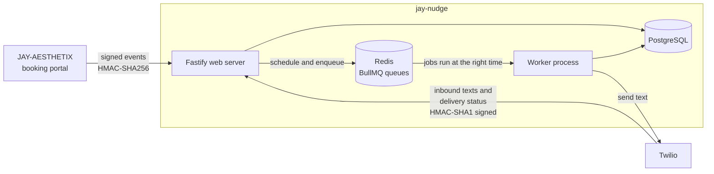
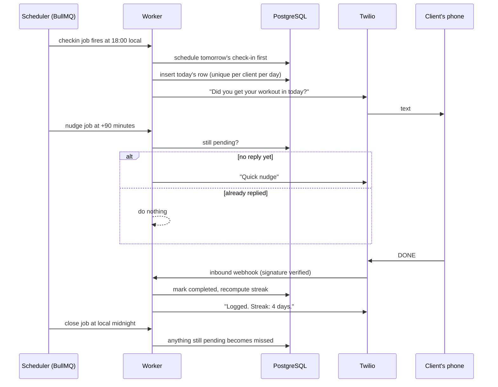
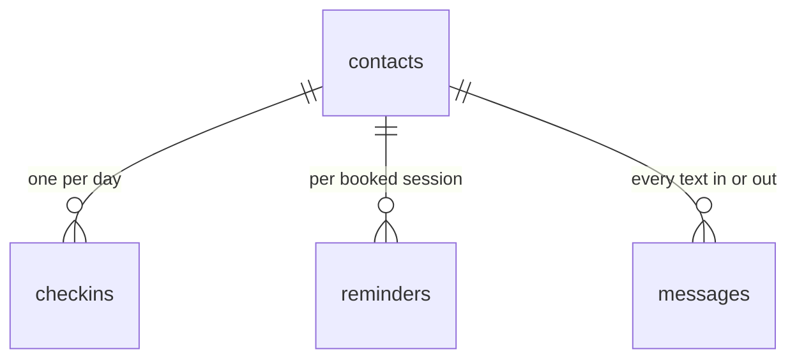

# jay-nudge: SMS Accountability Bot


A backend service that keeps personal-training clients accountable by text message. It sends session reminders,
asks every client "did you work out today?" at the same time each evening, nudges them if they don't answer,
understands their replies, and tracks their streak.

It is the companion to [JAY-AESTHETIX](https://github.com/jj375600/jay-aesthetix), a booking portal for a personal
trainer. JAY-AESTHETIX tells this service when a client opts in or books a session, over a signed webhook. Everything after that happens
in the background, with no web page involved.

**Stack:** TypeScript · Node 22 · Fastify · BullMQ + Redis · PostgreSQL · Twilio · Zod

## What it does

| Feature | Behaviour |
| --- | --- |
| Session reminders | A text 24 hours and 2 hours before each booked session, in the client's own time zone. Cancelling the session cancels its reminders |
| Daily check-in | At 18:00 local time: "Did you get your workout in today?" Replies: `DONE`, `SKIP` (rest day), `NO` |
| Automatic nudges | Up to two follow-ups (90 minutes apart) if there is no answer. Never at night, never after midnight, and silent if they already replied |
| Streaks | `STREAK` replies with the current streak, the best streak and the last 7 days. A rest day neither adds to a streak nor breaks it |
| Opt-out and opt-in | `STOP` works at once, from anywhere in a message, and nothing is sent afterwards, even jobs queued before it. `START` or `YES` brings them back |
| Reliable delivery | Rate-limited sending, retries with backoff for temporary Twilio errors, no retries for permanent ones, and a record of every text and its delivery status |

## Architecture



The web server never talks to Twilio. It validates a request, writes to Postgres, and puts a job in a queue. A separate worker
sends the texts. That keeps webhooks fast, makes retries safe, and means a Twilio outage can't lose a booking event.

### One day for one client



## Data model



Plus `events_seen`, which remembers every accepted event id so a retried delivery is processed once.

## Testing


118 automated tests run against the real server, a real Postgres and a real Redis. A small fake Twilio server records every text
"sent" and can be told to fail, so the retry and error paths are tested too. Highlights:

- **Signatures:** the Twilio check is verified against the worked example in Twilio's own documentation. Forged, edited,
  stale and replayed requests are all rejected and change nothing.
- **Time:** the 18:00 check-in lands on the right UTC instant in any zone, across daylight-saving changes and half-hour offsets.
- **Whole-day flows:** check-in, replies, nudges, closing a day as missed, and streak maths using SQL window functions.
- **Compliance:** `STOP` ends the check-in chain, cancels queued reminders' effect, and can't be overridden by a website event.
- **Exactly-once:** duplicate events, duplicate Twilio webhooks and duplicate send requests all produce one text.
- **Failure handling:** 5xx and 429 retried then succeed, permanent errors not retried, retries exhausted recorded as failed.

I also broke the code on purpose in ten places (skip the signature check, text opted-out people, drop the dedupe, retry permanent
errors, break the streak query, and so on) and confirmed the tests failed each time.

GitHub Actions runs typecheck, build, the full suite and a dependency audit with Postgres and Redis services. CodeQL scans the code and Dependabot keeps dependencies current.

## Run it locally

Requires Node 20.6+, Postgres and Redis (`docker compose up -d` starts both).

```bash
npm install
cp .env.example .env                     # then fill it in
docker compose up -d
npm run db:setup
npm run dev      # web server + worker + a fake Twilio (set TWILIO_API_BASE=http://localhost:4020 in .env)
```

To run the tests: `npm run build && npm run db:test`, then `npm run start:test` in one terminal and `npm test` in another.

### Using real Twilio

1. Create a Twilio account and a phone number. A trial account can only text numbers you have **verified** in the console.
2. Put the account SID, auth token and number in `.env`, and remove `TWILIO_API_BASE`.
3. Expose the server publicly (`ngrok http 4000`, or deploy it), set `PUBLIC_BASE_URL` to that exact https URL, and in the Twilio
   console point your number's "A message comes in" webhook at `<PUBLIC_BASE_URL>/webhooks/twilio/inbound` (HTTP POST).
4. Run `npm start` for the web server and `npm run worker` for the background worker.

## Connecting JAY-AESTHETIX

JAY-AESTHETIX sends JSON events to `POST /events` with a header `X-Nudge-Signature: t=<unix seconds>,v1=<hex>`, where
`v1 = HMAC-SHA256(EVENTS_SECRET, "<t>." + rawBody)`. Events are accepted for five minutes after `t`.

```json
{ "eventId": "b4f1...", "type": "client.opted_in",
  "client": { "id": "12", "name": "Maya Johnson", "phone": "+14045550123", "timezone": "America/New_York" } }

{ "eventId": "c9a2...", "type": "session.booked",
  "client": { "id": "12", "name": "Maya Johnson", "phone": "+14045550123" },
  "session": { "id": "345", "date": "2026-10-23", "startTime": "18:00", "focus": "Strength training" } }

{ "eventId": "d7e3...", "type": "session.cancelled", "session": { "id": "345" } }
```

| Response | Meaning |
| --- | --- |
| `200` | Accepted (or already seen: `{"duplicate": true}`) |
| `400` | Not valid JSON or fails validation (the reasons are returned) |
| `401` | Missing, wrong or stale signature |
| `422` | That phone number belongs to a different client |

## Design decisions

**A queue between the web server and Twilio.** A request to book a session should never wait on an SMS provider. Events and
webhooks only write to the database and enqueue a job. The worker does the slow, failure-prone work, and BullMQ gives retries,
delays and a rate limit for free.

**Idempotency everywhere, enforced by the database.** Delayed jobs, webhooks and sends can all happen twice. Each has a natural
unique key: one check-in row per client per day, one record per Twilio `MessageSid`, one send per `dedupe_key`, one event per id.
Postgres enforces them, so correctness doesn't depend on the code never running twice.

**Time zones are handled in the client's own zone.** "18:00" means 18:00 where the client is. The service converts it to a real UTC instant
for each day, so daylight-saving changes and half-hour offsets just work. Replies count for the day they arrive.

**Opt-out is checked at send time, not only at schedule time.** A reminder scheduled yesterday must not go out to someone who said STOP an hour ago.

**Errors are classified.** A 503 or a timeout is worth retrying; an invalid number is not, and burning retries on it would only delay
the failure record. Twilio's "recipient unsubscribed" error also flips the opt-out flag here.

## Project structure

```
src/server.ts      web server entry point         src/worker.ts    background worker entry point
src/app.ts         routes: /events, Twilio webhooks, /admin/summary, /health
src/handlers.ts    what each event and each text means
src/scheduler.ts   check-ins, nudges, end-of-day close, session reminders
src/outbound.ts    the single path every text takes: queue, dedupe, retry rules
src/twilio.ts      Twilio REST call and webhook signature check
src/events.ts      signed events from JAY-AESTHETIX
src/commands.ts    DONE / SKIP / NO / STREAK / STOP / START / HELP parsing
src/stats.ts       streaks with SQL window functions
src/time.ts        time-zone maths        db/schema.sql  tables and constraints
scripts/           fake Twilio, runner, schema setup      tests/  integration tests
```

See [SECURITY.md](SECURITY.md) for the threat model and known limitations.
